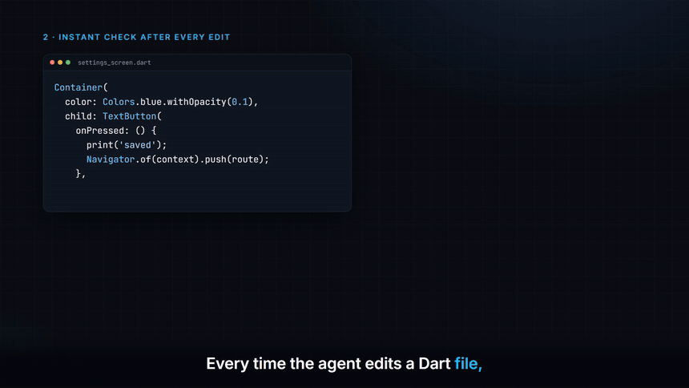

# Flutter Agent Plugins

[](https://pub.dev/packages/flutter_agent_toolkit)

Claude Code plugins that help AI agents build Flutter apps.

[](docs/demo.mp4)

▶ **[Watch the full 90-second video with sound](docs/demo.mp4)**

## flutter-agent-toolkit

Makes your AI agent build Flutter apps like a senior Flutter dev:

- **Knows your project**: Flutter version, state management, router, codegen, folder layout and team rules, from the first message
- **Modern APIs**: deprecated Flutter APIs are caught within 0.1 s of each edit, with the exact replacement
- **Clean before "done"**: `dart analyze` runs when the agent finishes, and problems go back to the agent to fix
- **Auto build_runner and format**
- **UI screenshots**: small phone, phone, dark mode, large text, tablet and desktop, with overflow detection and no emulator
- **Native build fixes**: Gradle, AGP, Kotlin, JDK, CocoaPods and Xcode error playbook
- **Team rules**: commit `.flutter-toolkit.yaml` and every agent on the team follows the same rules

### Install

In Claude Code:

```
/plugin marketplace add Tahmid1999/flutter-agent-toolkit
/plugin install flutter-agent-toolkit@flutter-agent-plugins
```

Then start a new session in a Flutter project and run `/flutter-init`.

Requires the Flutter SDK (`dart` on PATH). On Windows, Git Bash (included with Git for Windows).

**[Full documentation →](flutter-agent-toolkit/README.md)**

## License

[MIT](LICENSE)
